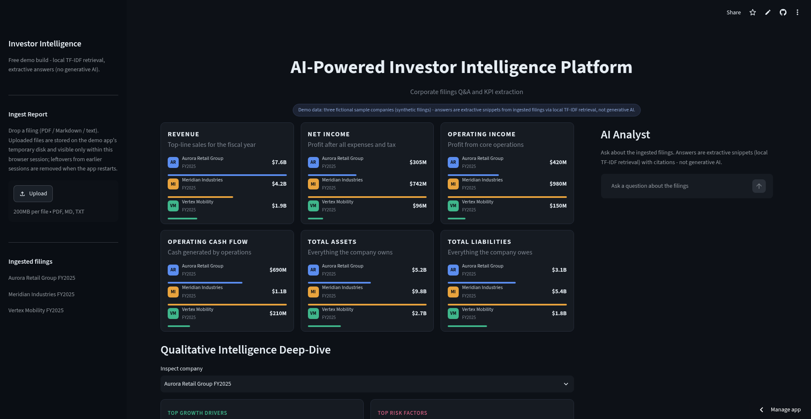
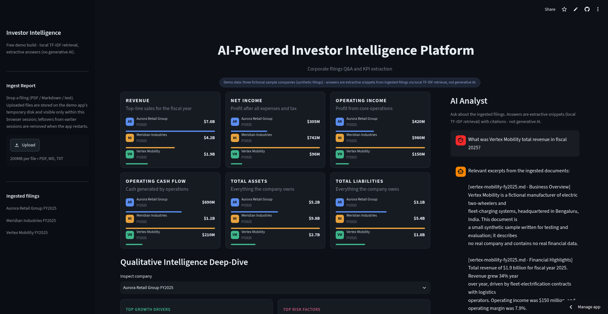

# AI-Powered Investor Intelligence Platform

Ask questions of company filings and get answers with source citations, extract headline KPIs automatically, and compare companies in a dark analytics dashboard.

**Live demo:** https://investor-intelligence-platform.streamlit.app
(free hosting - the app can take ~30 seconds to wake up)




## What it does

- Ingests filings (PDF, Markdown, text) with structure-aware chunking
- Extracts headline KPIs (revenue, net income, operating income, cash flow, total assets, total liabilities) into a queryable store
- Answers natural-language questions with extractive snippets and citations (source file, section, retrieval score)
- Dashboard compares KPIs across companies and surfaces growth drivers and risk factors
- FastAPI backend (`/ask`, `/ingest`, `/kpis`) plus a Streamlit UI, with Docker images for both services

## Tech stack

Python - FastAPI - Streamlit - scikit-learn (TF-IDF retrieval) - SQLite / PostgreSQL - Docker - GitHub Actions CI (lint, 15 tests, retrieval evaluation, Docker builds on every push)

Implemented and verified locally: structure-aware ingestion (PDF / Markdown / text), KPI extraction, TF-IDF retrieval with extractive cited answers, the FastAPI backend and the Streamlit dashboard.

Wired but not yet verified: OpenAI / Azure OpenAI embeddings and LLM-written answers, behind configuration - no API key has been run against them.

## Architecture

```
filings (.md/.txt/.pdf)
      |
      v
 ingestion (structure-aware chunking) ---> KPI extraction ---> SQLite / PostgreSQL
      |
      v
 embeddings + vector store
   (local TF-IDF - verified | OpenAI embeddings - optional, unverified)
      |
      v
 retriever ---> answer chain ---> FastAPI (/ask, /ingest, /kpis) ---> Streamlit UI
                     |
              local mode: quotes retrieved excerpts verbatim
              LLM mode (unverified): instructs the model to use only the
              retrieved context - reduces, but cannot eliminate, the risk of
              invented content
```

Every answer carries citations (source file, section, retrieval score).

## Quickstart (local, no API keys needed)

```bash
python -m venv .venv && source .venv/bin/activate
pip install -r requirements-dev.txt
pip install -e .
uvicorn investor_intel.api.app:app --reload   # API on :8000
streamlit run src/investor_intel/ui/streamlit_app.py  # UI on :8501
```

Ingest the sample filing and ask a question:

```bash
curl -X POST localhost:8000/ingest -H 'content-type: application/json' \
  -d '{"path": "data/sample/meridian-industries-fy2025.md"}'
curl -X POST localhost:8000/ask -H 'content-type: application/json' \
  -d '{"question": "What was total revenue in fiscal 2025?"}'
```

Server-side ingestion is restricted to the configured data directory
(`II_DATA_DIR`, default `./data`); other paths are rejected. Use
`POST /ingest/upload` (multipart) for arbitrary files. PDF ingestion uses
`pymupdf4llm` (included in `requirements.txt`). Set `LLM_PROVIDER=openai` (or `azure-openai`) and
`II_EMBEDDINGS_PROVIDER=openai` with the variables in `.env.example` to
switch on the (unverified) semantic/LLM mode.

## Evaluation

`python evaluation/run_eval.py` runs two suites and writes
`evaluation/eval_report.md` with the measured numbers:

- Single filing: retrieval hit@3 by expected section - **5/6** on the
  current sample filing (the supply-chain question falls outside the top 3
  since the filing grew; rerunning the eval reproduces the number).
- Three filings: cross-company ranking - **hit@1 6/6, hit@3 6/6** on
  questions naming a specific company. This suite guards the entity-aware
  re-ranking in `rag/retriever.py` that keeps a question about one company
  from surfacing another company's shared financial boilerplate first.

Scope of these numbers: the golden sets are authored for this project
against fictional sample filings. They are wiring smoke tests, not an
independent benchmark, and not a measure of answer correctness or general
accuracy. Chunk text is embedded together with its section heading, which
closes vocabulary gaps like "supply chain" vs "semiconductor suppliers".

## Testing

`pytest -q` - 15 tests covering chunking, embeddings, retrieval, KPI
extraction, the API flow, ingest path sandboxing, file upload, and PDF
ingestion. CI (`.github/workflows/ci.yml`) installs the full dependency set
(so the PDF test runs there too), then lints, tests, evaluates and builds
both Docker images on every push and PR.

## Deployment

- `docker-compose.yml` runs api + ui locally.
- `docker/api.Dockerfile`, `docker/ui.Dockerfile` build the two services.
- Live demo on Streamlit Community Cloud (free tier): https://investor-intelligence-platform.streamlit.app
- `.github/workflows/cd-aks.yml` (manual trigger only) builds, pushes to
  Azure Container Registry and applies `k8s/` to AKS. It needs repo
  secrets/vars (`AZURE_CREDENTIALS`, `ACR_NAME`, `AKS_CLUSTER`,
  `AKS_RESOURCE_GROUP`) and a pre-created `investor-intel-secrets`
  kubernetes secret - see `k8s/secrets.example.yaml`. Deploying creates paid
  Azure resources.

## Honest status

- Verified locally (no paid services): 17/17 tests pass; retrieval smoke
  evals reproduce at 5/6 (single filing, hit@3) and 6/6 hit@1
  (cross-company ranking) - see Evaluation; ingest -> ask -> KPI
  flow works end to end on the sample filing without API keys; PDF ingestion
  verified with `pymupdf4llm` on a generated test PDF.
- Retrieval today is lexical (TF-IDF keyword matching). Semantic embeddings
  and LLM-written answers are wired behind the OpenAI / Azure OpenAI
  configuration but are NOT verified - no API key has been run against them.
- Docker images are not built locally (no Docker daemon in the dev
  environment); CI builds them on every push, which is their first real
  verification.
- AKS deployment is untested, needs an Azure subscription, and creates paid
  resources.
- The sample filing in `data/sample/` is fictional and exists for testing.
  The evaluation golden set was authored for this project against that
  filing; it is not independent evidence of quality.

## License

MIT - see [LICENSE](LICENSE).
